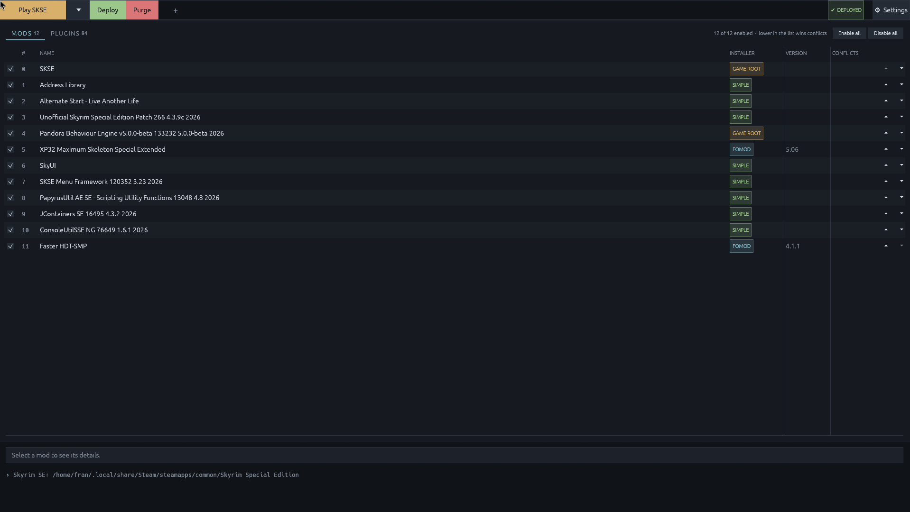

# Skald

**A mod manager for Skyrim Special Edition on Linux.**



Skald installs your Skyrim mods, lets you choose options when a mod offers them, and puts
everything into the game with one click. It works with the Steam version of Skyrim SE running
through Proton. You don't need Wine tricks or Windows tools.

> Want to know how it works inside? See [README-TECHNICAL.md](README-TECHNICAL.md).

---

## What you need

- **Skyrim Special Edition** from Steam, launched at least once.
- **Rust**, to build Skald. If you don't have it, follow the instructions at <https://rustup.rs>.
- **unrar**, only if you have mods in `.rar` files. On Arch/CachyOS: `sudo pacman -S unrar`.

## Starting Skald

Open a terminal and run:

```sh
cd ~/Projects/skald
cargo run --release
```

The first start takes a few minutes while it builds. After that it opens straight away.

Skald finds Skyrim by itself, including on extra Steam drives and Flatpak Steam. The log at the
bottom of the window says where it found the game. If it says **"Skyrim Special Edition was not
found"**, open **⚙ Settings**, click **Browse…** and pick the folder that contains `SkyrimSE.exe`.

---

## Installing a mod

1. Download the mod (for example from Nexus Mods, using **Manual download**).
2. **Drag the file onto the Skald window.** `.zip`, `.7z` and `.rar` all work, and so does an
   already-extracted mod folder. You can drop several at once.
3. If the mod is a plain one with nothing to choose, Skald installs it straight away. Otherwise an
   install window opens. What it shows depends on the mod:

| What you see | What to do |
|---|---|
| **Step-by-step installer** with options and pictures | Pick the options you want. Point at an option to see its description and picture on the right. Click **Next ▶** to go on and **Back** to change earlier choices, then **Install**. |
| **A checklist of packages** (`00 Core`, `10 Option`…) | Tick the parts you want. The core package is ticked for you. Click **Install**. |
| **A list of files** | You already have a mod with this name. Choose to replace it or keep both, then click **Install**. |
| **"This mod installs into the game folder"** | It's a tool like SKSE or an ENB. Click **Install**. Skald puts it next to the game's `.exe` for you. |
| **A folder tree** | Skald couldn't tell how this mod is laid out. Pick the folder that holds things like `meshes`, `textures` or `.esp` files (Skald shows good candidates in **green**). Click **Install**. |

You can rename the mod at the top of that window. If you install a mod you already have, Skald
asks whether to **replace it** or **keep both**.

Labels next to options in a step-by-step installer:
- **required**: always installed, can't be unticked.
- **recommended**: the mod author suggests it.
- **not usable**: won't work with your setup, so it's greyed out.

## Putting mods into the game: Deploy

Installing a mod only stores it inside Skald. Your game folder isn't changed yet.

When you're ready, click **Deploy**. Skald adds all **ticked** mods to the game. The top bar
shows **Changes not deployed** (yellow) when you've changed something since the last deploy, and
**Deployed** (green) when the game is up to date.

Then click **Play** to start Skyrim through Steam.

## Taking mods out again: Purge

Click **Purge** to remove every mod from the game folder. This returns Skyrim to the way it was
before Skald touched it. Your mods stay safe inside Skald, so you can deploy them again any time.

If a mod replaced one of the game's own files, Skald kept the original and puts it back on Purge.

---

## The main window

### Tools tray

Some mods come with a program you run yourself, like BodySlide or xEdit. Next to **Purge** at
the top there's a row of icons, one for each program you've added:

- Click **+** and pick the program's `.exe`. It goes into the row with its own icon.
- Click an icon to run that program. It runs with the same Proton as Skyrim.
- Right-click an icon and choose **Remove from tray** to take it out.

If the program comes from a mod, **Deploy** first, then add it from the game's `Data` folder (the
picker opens there). An icon with a red line means its `.exe` isn't there. Usually you just need
to deploy again.

### Tabs

The main area has two tabs at the top: **Mods** and **Plugins**. Click one to switch lists.
**Enable all** and **Disable all**, on the right of the tabs, switch every entry in the open list on or off.

### Mods tab
- **Checkbox**: tick to use the mod, untick to switch it off without deleting it.
- **⏶ ⏷**: move the mod up or down. **When two mods change the same file, the one lower in the
  list wins.** Put patches and fixes below the mods they change.
- **Conflicts**: **▲5** in green means this mod overrides 5 files from mods above it.
  **▼3** in red means 3 of its files are overridden by mods below it. This is normal, and the
  numbers just help you see who wins.
- **Right-click a mod** to rename it, open its folder, or remove it.

After changing anything here, click **Deploy** again.

### Plugins tab
These are the `.esp`, `.esm` and `.esl` files that the game loads. They're split into two groups
you can fold open or closed by clicking the group's title: **Base game & DLC** (closed at first) and
**Mods**. Each title shows how many of its plugins are on.
- **Checkbox**: turn a plugin on or off.
- **⏶ ⏷**: change the load order.
- Grey plugins are the base game and Creation Club content. They always load first and can't be moved
  or switched off, not even with **Disable all**.
- Blue plugins are **masters** (ESM). They always stay above normal plugins.
- **ESL** means a light plugin, which doesn't count toward the game's plugin limit.
- **UNMANAGED** means the plugin is in the game's `Data` folder but Skald didn't install it. It's
  usually left over from installing mods by hand or with another mod manager.
- **Remove unmanaged** (top right) moves every unmanaged plugin out of `Data` and into
  `~/.local/share/skald/unmanaged/`, so the game stops loading them. Nothing is deleted: to get a
  plugin back, move it from there back into `Data`. Other files from those old mods (textures,
  meshes, `.bsa` archives) stay where they are.
- **Sort (LOOT)** (top right) puts your plugins in a good load order using
  [LOOT](https://loot.github.io)'s rules. Skald fetches the latest rules from the internet each time,
  so you need a connection the first time (later it uses the saved copy if you're offline). LOOT's
  notes, such as a plugin that needs cleaning or a missing requirement, show up in the log at the
  bottom. You can still move plugins by hand afterwards. Notes about the base game and Creation Club
  plugins are left out, because you can't change those here.

Plugin changes are saved **straight away**, with no Deploy needed. New mods' plugins are switched
on automatically.

### Bottom panel
Shows details of the selected mod and a log of what Skald did. Errors are shown in red.

---

## Settings

Click **⚙ Settings**:

- **Skyrim SE folder**: where `SkyrimSE.exe` is. **Auto-detect** finds it again.
- **Plugins.txt folder**: where the game keeps its plugin list. It's filled in automatically, so
  you normally don't need to touch it.
- **Mods folder**: where Skald keeps your installed mods. Click **Open** to see them.
- **Deploy method**: leave it on **Hardlink (recommended)**. It's fast and uses no extra disk space.
  **Copy** uses more space but works everywhere.
- **Proton**: used when **Play** starts something other than Steam (e.g. SKSE). Leave it empty
  to use the same Proton that Steam uses for Skyrim.
- **Play menu programs**: programs you added with **Add program…**. Click ✖ to remove one.

---

## Common questions

**Does Skald change my mod files?**
No. Mods are kept unchanged in their own folder. Deploy only adds links to them in the game folder.

**Where are my mods stored?**
In `~/.local/share/skald/mods/`. Open **⚙ Settings** and click **Open** next to **Mods folder** to see them.

**I removed a mod but it's still in the game.**
Click **Deploy**. Changes in the mod list only reach the game when you deploy.

**A mod's installer has options I don't understand.**
Leave the defaults. Mod authors pre-select the safest choices.

**It says "FOMOD (C# script)" and shows a folder tree.**
A few old mods use a script-based installer that can't run on Linux. Pick the folder with the mod's
files (usually the green one) and install.

**Steam updated Skyrim and now something is broken.**
Click **Purge**, then **Deploy**. If Steam changed a file while it was in use by a mod, Skald
keeps Steam's new version and saves the old one beside it with `.skald-original` added to its name.

**My `.rar` mod won't install.**
Install `unrar` (see [What you need](#what-you-need)).

**How do I use SKSE?**
Install the SKSE archive like any other mod (Skald recognises it) and deploy. Then open the small
menu next to **Play** and pick **SKSE**. From then on, Play starts the game through SKSE. Keep
Steam running: Skyrim needs it.

**Can Play start something else, like xEdit or BodySlide?**
For tools like these, use the [tools tray](#tools-tray): click **+** next to **Purge**.
To start the game itself through another program, choose **Add program…** in the menu next to
**Play** and pick its `.exe`. You can remove it again in **⚙ Settings**.

---

## What Skald doesn't do (yet)

- Only Skyrim Special Edition from Steam.
- No "Download with Manager" button from Nexus. Use manual downloads.
- No separate mod profiles.
